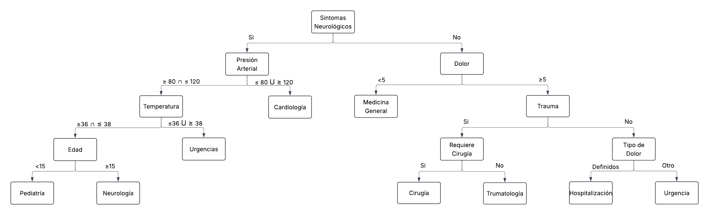

# Taller 2 - Estructura de Datos

## Integrante

| Nombre                         | RUT          | GitHub                   | Carrera |
| ------------------------------ | ------------ | ------------------------ | ------- |
| Victor Manuel González Morales | 22.061.552-9 | VictorgGonzalezMorales-1 |  ICI    |
## Descripción

Este proyecto es la **continuación y extensión del Taller 1 de Estructura de Datos**.

Consiste en un **sistema automatizado de gestión hospitalaria** en C++ que recibe un flujo de pacientes desde un archivo de texto utilizando una **cola manual**, los **clasifica dinámicamente mediante un árbol de decisión clínico**, y finalmente **almacena las fichas en árboles AVL** balanceados por cada departamento médico **para optimizar los tiempos de búsqueda y atención**.

## Estructuras Utilizadas

El sistema utiliza las siguientes estructuras:

- **Nodo (Node):** Clase genérica utilizada como elemento fundamental para construir las estructuras enlazadas. Cada nodo almacena un dato y un puntero hacia el siguiente nodo.

- **Lista enlazada (List):** Estructura genérica implementada manualmente mediante nodos y punteros. Se utiliza para almacenar y organizar distintos tipos de datos dentro del programa. Entre sus usos se encuentra el manejo de datos obtenidos al separar las líneas del archivo, el almacenamiento de los IDs procesados para controlar pacientes duplicados.

- **Cola (Queue):** Estructura implementada manualmente mediante nodos y punteros. Almacena los pacientes pendientes de atención respetando el orden de llegada.

- **Nodo de Árbol (NodeArbol):** Clase genérica utilizada como elemento fundamental para la construcción de distintos tipos de árbol como lo es un árbol de decisión.

*Rellenar*
## Estructura del Proyecto


```text
Taller-2-Estructura/
│
├── documentos/
│   └── Arbol_de_Decision_Tipo_de_Servicio.png
│
├── dominio/
│   ├── Paciente.h
│   └── Paciente.cpp
│
├── estructuras/
│   ├── Node.h
│   ├── NodeArbol.h
│   ├── List.h
│   ├── Queue.h
│   └── Stack.h
│
├── logica/
│   ├── Sistema.h
│   └── Sistema.cpp
│
├── CMakeLists.txt
├── main.cpp
└── Pacientes.txt
```

*Rellenar*
## Archivo de Pacientes

Cada línea del archivo representa una ficha médica y debe contener los siguientes **atributos en orden estricto**, separados por punto y coma (`;`):

```text 
ID;Nombre;Edad;Temperatura;PresionArterial;Dolor;TipoDolor;Trauma;SintomasNeurologicos;RequiereCirugia;DiasHospitalizacion 
```
### Desglose de los Campos:

* **ID:** Código alfanumérico único identificador del paciente. `(ej: `001`)`
* **Nombre:** Nombre y apellido del usuario.  `(ej: Damian Valdivia)`
* **Edad:** Valor numérico entero que representa la edad en años. `(ej: 20)`
* **Temperatura:** Valor de la temperatura corporal. `(ej: 37.2)`
* **PresionArterial:** Métrica numérica entera de la presión arterial sistólica. `(ej: 80)`
* **Dolor:** Escala de intensidad del malestar físico evaluada de `0` (nulo) a `10` (máximo).
* **TipoDolor:** Cadena de texto descriptiva (`pecho`, `cabeza`, `abdomen`, `extremidad` u `otro`).
* **Trauma:** Indicador binario de lesión por impacto físico (`1` si existe, `0` si no existe).
* **SintomasNeurologicos:** Indicador binario de compromiso del sistema nervioso (`1` si presenta, `0` si no presenta).
* **RequiereCirugia:** Indicador binario de urgencia quirúrgica evidente (`1` si requiere, `0` si no requiere).
* **DiasHospitalizacion:** Estimación entera de jornadas consecutivas que el paciente requerirá una cama de internación. `(ej: 4)`

### Ejemplo

```text 
001;Damian Valdivia;25;37.0;115;3;otro;0;0;0;0 
```

## Robustez y Validaciones de la lectura de archivo

El módulo de carga de datos en `Sistema.cpp` somete a cada línea del archivo `Pacientes.txt` a un **estricto proceso de filtrado y control de calidad antes de ingresarlo a la cola de espera, garantizando la estabilidad de la memoria y previniendo caídas del programa**:

### 1. Validaciones de Estructura y Formato
* **Conteo Clínico Completo:** Se verifica mediante análisis de tokens que cada registro contenga exactamente los **11 campos obligatorios** separados por `;`. Líneas con datos faltantes o sobrantes son descartadas inmediatamente.
* **Campos no Vacíos:** Se controla que no existan puntos y comas consecutivos (`;;`), asegurando que cada atributo tenga un valor asignado antes de ser analizado.

### 2. Validaciones de Tipos de Datos y Rangos (Robustez Clínica)
* **Control de Excepciones de Conversión (`try-catch`):** Las conversiones de texto a numérico (`std::stoi` para enteros y `std::stod` para Doubles) están protegidas en bloques de código seguros. Si un campo numérico contiene texto corrupto (ej: letras en la edad o temperatura), el error es capturado.
* **Consistencia de Rango de Datos:**
    * El **ID**, **Edad**, **Temperatura**, **PresionArterial** y **DiasHospitalizacion** deben ser estrictamente positivos.
    * La escala de **Dolor** se restringe estrictamente al rango de `0` a `10`.
    * Los campos binarios (**Trauma**, **SintomasNeurologicos**, **RequiereCirugia**) solo aceptan los valores `0` o `1`.
    * El **TipoDolor** se valida contra las cadenas permitidas (`pecho`, `cabeza`, `abdomen`, `extremidad`, `otro`).

### 3. Control de Integridad y Duplicados
* Antes de procesar o encolar, el sistema realiza una búsqueda de comprobación en los **IDs ya procesados** para asegurar que el **ID del paciente no se encuentre repetido** en el hospital. Si el ID ya existe en el sistema, el registro se omite para evitar colisiones de claves.

### 4. Política ante Datos Inválidos o Fallos Clínicos
* **Archivo Inexistente:** Si el archivo físico `Pacientes.txt` no es detectado en la raíz por el flujo `std::ifstream`, el programa despliega un mensaje aclaratorio en la interfaz de consola y detiene de forma controlada la carga de datos para evitar un puntero nulo.
* **Estrategia de Rescate ante Fichas Corruptas:** Si una línea supera las pruebas de formato pero contiene un dato clínico fuera de rango o corrupto, el motor sistema no detiene el programa; en su lugar, captura el caso límite y asigna al paciente de forma segura al servicio general por defecto (**Medicina General**) para garantizar su atención y proteger el flujo del software.

## Definición del servicio del Paciente



### Justificación de los Criterios Clínicos

1. **Síntomas Neurológicos:** Es el filtro prioritario (raíz). Cualquier alteración en el sistema nervioso central representa un riesgo latente de secuelas graves, por lo que segmenta inmediatamente la ruta hacia las especialidades de alta complejidad.

2. **Rangos de Presión y Temperatura:** Las mediciones alteradas fuera de los rangos fisiológicos estándar.
    1. $]-\infty, 80[ \; \cup \; ]120, \infty[$        (Presión)
    2. $]-\infty, 36.0[ \; \cup \; ]38.0, \infty[$        (Temperatura)

   denotan inestabilidad hemodinámica, ruteando al paciente de urgencia o directo a Cardiología si se sospecha un evento cardiovascular.

3. **Escala de Dolor:** Actúa como el gran divisor de gravedad para pacientes sin compromiso neurológico. Un dolor bajo **(Menor que 5)** permite una derivación segura a Medicina General, optimizando los recursos críticos para los casos de dolor agudo **(Mayor que 5)**.

4. **Trauma y Requerimiento Quirúrgico:** Ante la presencia de lesiones físicas por impacto, se discrimina si el tejido comprometido exige pabellón inmediato (Cirugía) o si corresponde a un manejo ortopédico/óseo inmovilizable (Traumatología).

5. **Tipo de Dolor Clínico:** Si el dolor es severo pero no proviene de un trauma externo, las localizaciones anatómicas clave ("pecho", "cabeza", "abdomen", "extremidad") ameritan un monitoreo controlado en cama (Hospitalización), mientras que dolores no catalogados u "otros" ingresan a observación en Urgencias.

## Instrucciones de Compilación y Ejecución

El proyecto está diseñado y garantizado para compilar en un entorno **GitHub Codespace** utilizando CMake y GCC.

### Comando Único (Actualizar, Compilar y Ejecutar)
Para realizar todo el ciclo de pruebas de un solo golpe, copia y pega la siguiente línea en la terminal de tu Codespace:

```bash
cd /workspaces/Taller-2-Estructura && git pull && mkdir -p build && cd build && cmake .. && make && ./Taller-2-Estructura
```

### Comandos Paso a Paso (Alternativa)
Si prefieres ejecutar los comandos de forma manual y secuencial:

1. **Regresar a la raíz y descargar cambios:**
   ```bash
   cd /workspaces/Taller-2-Estructura && git pull
   ```
2. **Crear e ingresar al directorio de construcción:**
   ```bash
   mkdir -p build && cd build
   ```
3. **Generar los archivos de configuración con CMake:**
   ```bash
   cmake ..
   ```
4. **Compilar el código fuente:**
   ```bash
   make
   ```
5. **Ejecutar la aplicación:**
   ```bash
   ./Taller-2-Estructura
   ```

## Ejecución y Flujo del Sistema

*Rellenar*
## Servicios disponibles

El **Hospital Marmaja** considera los siguientes servicios:

1. Urgencias
2. Medicina General
3. Cardiologia
4. Neurologia
5. Traumatologia
6. Cirugia
7. Pediatria
8. Hospitalizacion

## Organización del código

El proyecto se encuentra dividido en diferentes módulos:

* **`documentos/`** : Contiene los diagramas y material complementario del diseño clínico, como el archivo `Arbol_de_Decision_Tipo_de_Servicio.png`.
* **`dominio/`** : Contiene la clase `Paciente` (`Paciente.h` y `Paciente.cpp`), encargada de encapsular los atributos y variables de la ficha médica.
* **`estructuras/`** : Contiene las implementaciones manuales de las estructuras de datos fundamentales: `Node`, `NodeArbol`, `List`, `Queue` y `Stack`.
* **`logica/`** : Contiene la interfaz `Sistema` (`Sistema.h` y `Sistema.cpp`), que maneja el controlador del flujo hospitalario, la validación de datos y el motor de clasificación de pacientes.
* **`main.cpp`** : Contiene el flujo principal del programa, la inicialización del sistema y el menú interactivo para el usuario.
